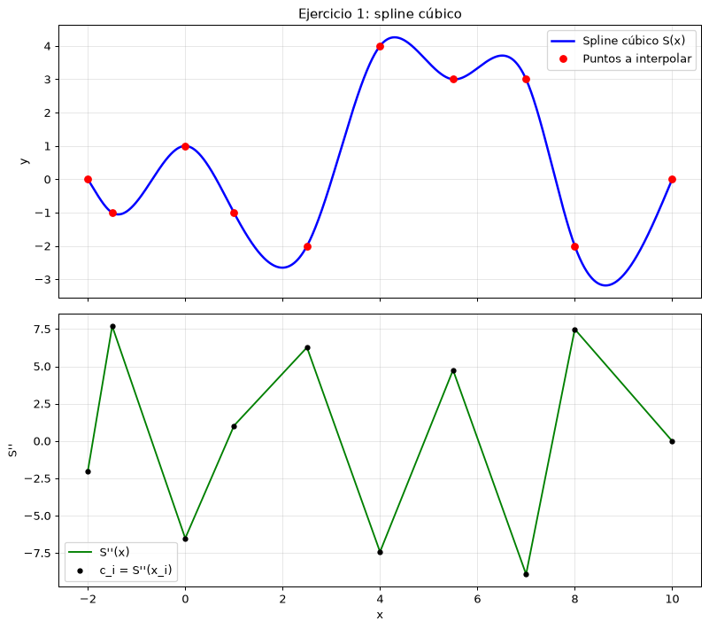
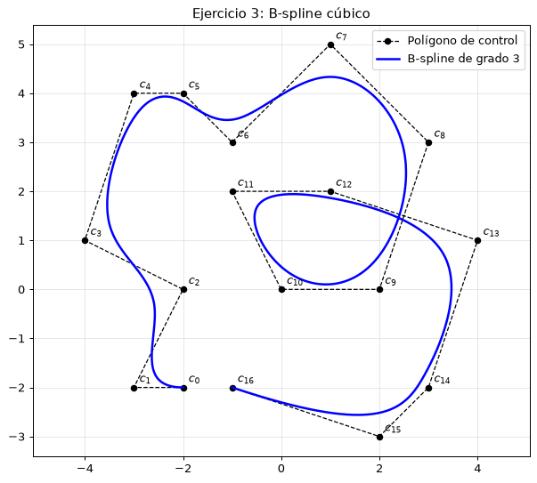

# Métodos Numéricos para la Informática

Prácticas de la asignatura **Métodos Numéricos para la Informática** (Grado en Ingeniería Informática, Universidade da Coruña, curso 2026/2027).

En las prácticas he implementado desde cero, en Python, los algoritmos numéricos vistos en teoría, sin recurrir a las rutinas de resolución de NumPy (que solo utilizo para verificar los resultados). La primera práctica se centra en el álgebra lineal numérica y la segunda aplica esos métodos a la construcción de curvas para gráficos por computador.

## Contenido

| Práctica | Tema | Métodos |
|---|---|---|
| [P1 · Sistemas de ecuaciones lineales](p1-sistemas-lineales) | Álgebra numérica matricial | Factorización LU, Cholesky, LU tridiagonal, Gauss-Seidel, potencia iterada |
| [P2 · Gráficos por computador](p2-graficos-por-computador) | Curvas paramétricas | Spline cúbico, Bézier (De Casteljau), conexión de curvas, Bézier racional, B-splines (De Boor) |

<p align="center">
  
  
</p>

## Tecnologías

- **Python 3**
- **NumPy** (estructuras de datos y verificación de resultados)
- **Matplotlib** (representación de curvas)

## Ejecución

Cada práctica tiene su propio `requirements.txt` y se lanza desde su carpeta indicando el apartado:

```bash
cd p2-graficos-por-computador
python3 -m venv .venv
.venv/bin/pip install -r requirements.txt
.venv/bin/python main.py 2c
```
