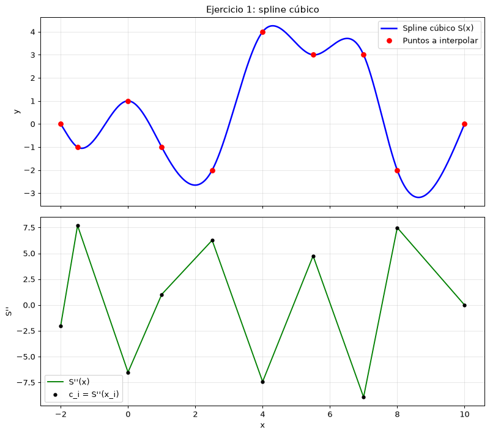
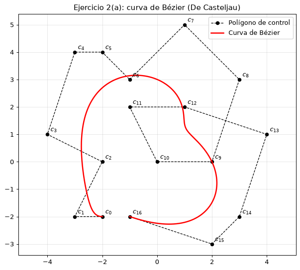
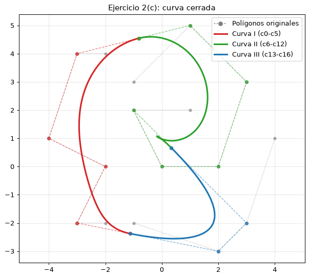
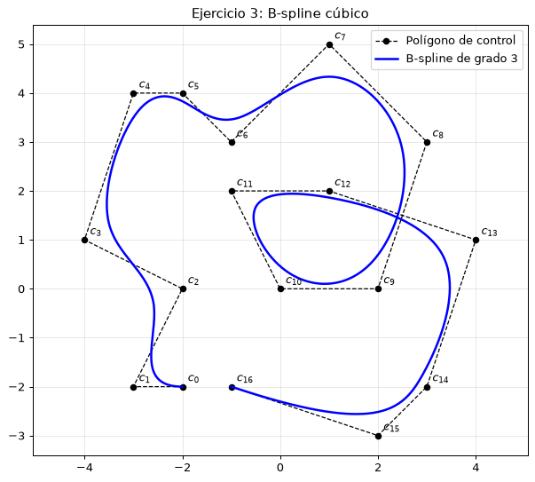

# Práctica 2 · Métodos numéricos para gráficos por computador

Implementación en Python de las principales técnicas de construcción de curvas utilizadas en gráficos por computador: interpolación mediante **splines cúbicos**, **curvas de Bézier** (polinómicas y racionales) y **B-splines**. Los algoritmos están programados desde cero y reutilizan los métodos directos desarrollados en la [Práctica 1](../p1-sistemas-lineales).

## Ejercicios

### 1 · Spline cúbico de interpolación

Construcción del spline cúbico que interpola diez puntos con condiciones prefijadas sobre la segunda derivada en los extremos. Los coeficientes se obtienen resolviendo un **sistema tridiagonal** con la factorización LU de la Práctica 1. Además, el programa comprueba numéricamente que el spline pasa por todos los puntos y que la primera y la segunda derivada son continuas en los nodos interiores; los errores obtenidos son del orden de 10⁻¹⁵.

<p align="center"></p>

### 2 · Curvas de Bézier

- **(a) Algoritmo de De Casteljau** para evaluar la curva de Bézier de 17 puntos de control.
- **(b)** División en tres curvas independientes.
- **(c) Conexión de curvas.** Unión de las tres curvas en una curva cerrada de clase C¹ aplicando la condición de conexión con tangente continua. Para respetar el requisito de *mínimas modificaciones*, en cada unión solo se mueven los dos extremos que se tocan, que pasan a ser un único punto.
- **(d) Bézier racional** mediante la versión con pesos del algoritmo de De Casteljau. Los pesos de las esquinas del polígono se aumentan para que la curva se acerque a ellas.
- **(e) Interpolación con Bézier.** Cálculo de los puntos de control para que la curva pase exactamente por un conjunto de puntos en 3D, resolviendo el sistema lineal resultante con la factorización LU de la Práctica 1.

<p align="center">
  
  
</p>

### 3 · B-spline cúbico

Construcción de un B-spline de grado 3 con **vector de nodos uniforme abierto** y evaluación mediante el **algoritmo de De Boor**. A diferencia de la curva de Bézier global, cada punto de control solo influye en un tramo local de la curva.

<p align="center"></p>

## Requisitos y dependencias

- **Python 3**
- Librerías nativas de Python utilizadas: `sys`, `math`
- **NumPy** y **Matplotlib** (versiones en `requirements.txt`)

Instalación en un entorno virtual:

```bash
python3 -m venv .venv
.venv/bin/pip install -r requirements.txt
```

## Estructura del proyecto

- `main.py`: archivo principal de control y selección de apartados.
- `data.py`: datos del enunciado (puntos, condiciones, pesos, puntos a interpolar).
- `sistemas_lineales.py`: métodos directos de la Práctica 1, LU tridiagonal (spline) y LU de Doolittle (interpolación de Bézier).
- `spline.py`: ejercicio 1, cálculo, evaluación, comprobación y representación del spline cúbico.
- `bezier.py`: ejercicio 2, algoritmo de De Casteljau, conexión de curvas, Bézier racional e interpolación con curvas de Bézier.
- `bspline.py`: ejercicio 3, nodos uniformes abiertos y algoritmo de De Boor.
- `docs/`: enunciado e imágenes de los resultados.

## Ejecución

Para ejecutar la práctica, lanza el script principal indicando el apartado:

- **1**: spline cúbico con S''(x₀) = −2 y S''(xₙ) = 0
- **2a**: curva de Bézier con los 17 puntos de control (De Casteljau)
- **2b**: tres curvas de Bézier (puntos 0-5, 6-12 y 13-16)
- **2c**: unión de las tres curvas en una curva cerrada
- **2d**: curva de Bézier racional con los puntos 2-11
- **2e**: curva de Bézier que interpola los puntos 3D
- **3**: B-spline cúbico con nodos uniformes abiertos

Ejemplo de ejecución para el apartado 2c:

```bash
.venv/bin/python main.py 2c
```

Cada apartado abre una ventana con la gráfica. El apartado 1 imprime además la comprobación numérica del spline y el 3, el conjunto de nodos.

### Apreciaciones

- 2(c): la unión se hace de clase C¹ con la fórmula de conexión de curvas vista en teoría; en cada unión solo se modifican los dos extremos que se tocan.
- 2(d): el enunciado no indica los pesos; se definen en `data.py` (`pesos_racional`) y pueden cambiarse libremente.
- 2(e): se toman parámetros equiespaciados tᵢ = i/n.
